# Cost-Aware Formulation Optimizer

**Recommends the next lab experiment on the cheapest path to a formulation that passes every spec, and weighs what each run will teach against what it costs to run.**

## The problem in business terms

Companies that develop coatings, adhesives, concrete or polymer compounds pay for every development experiment: trial batch materials, line or oven time, technician hours and testing, plus calendar time that can cost a customer qualification window. Labs usually plan experiments with experience, a designed experiment fixed up front, and gut feel. They rarely account for which runs are expensive, and they rarely re-optimize when raw material prices move. This project builds a tool that targets the business question directly, "what is the cheapest recipe that passes spec, found for the least lab spend?", and benchmarks it fairly against random search, classic design of experiments (DOE) and standard Bayesian optimization (BO). All prices and run costs are illustrative and configurable in `config.yaml`.

## v2 findings (pre-registered, new seeds 31 to 130)

v2 asked three questions: does cost-aware BO pay off more when run costs differ more (H1), does v1's one apparent cost-aware win replicate on new seeds (H2), and how does the concrete "0 % success" depend on the 5 % line. It also moved the lab-note risk label into code and tried batch suggestions. The plan, metrics and decision rules were committed in [`docs/PREREGISTRATION_v2.md`](docs/PREREGISTRATION_v2.md) before any v2 run; `git log` shows that commit before every commit with reporting-seed results. **There were no deviations from the pre-registration.** Every table in this section is copied from [`reports/v2/tables_v2.md`](reports/v2/tables_v2.md), which `scripts/report_tables_v2.py` generates from the files in `reports/v2/`.

**Summary**

- **H1 failed: not supported.** Making run costs more uneven did not make cost-aware BO better than plain constrained BO on the synthetic enamel problem. For the pre-registered headline method (`bo_cost_cooled`) the growth in its advantage from s = 1 to s = 10 is -255 [-881, 338] dollars of spend-to-target saved and -0.010 [-0.110, 0.100] in success rate: the wrong sign on both co-primary metrics, with intervals that include zero ([`reports/v2/analysis/h1_growth.csv`](reports/v2/analysis/h1_growth.csv)). The fixed-alpha variant `bo_cost` gives the same verdict.
- **Cost-awareness never started to pay at any tested spread.** Not at s = 3, not at s = 10, and not at the v1 run cost (effective s = 6.3465, drawn hollow in the figure). No level met the pre-registered rule ([`reports/v2/analysis/h1_h2_results.json`](reports/v2/analysis/h1_h2_results.json)).
- **H2 failed: did not replicate.** v1's success gain of `bo_cost` over plain BO (+0.233 on seeds 0 to 29, noticed after the fact) is 0.020 [-0.090, 0.130] on 100 new seeds: success 0.390 versus 0.370, with 19 seeds where only `bo_cost` succeeded and 17 where only plain BO did ([`reports/v2/analysis/h2.csv`](reports/v2/analysis/h2.csv)).
- **What cost-awareness did do** (descriptive, no claim): at s = 10 the cost-aware methods ran cheaper experiments ($676 and $692 per run against $726 for plain BO) and so fitted a few more runs into the budget, and their mean best-cost curve runs a little lower in mid-budget (figure below). By the end of the budget that had not turned into reaching the 5 % target sooner or more often.
- **v1's main result holds on new seeds.** At v1 settings on seeds 31 to 130, the BO variants reached the target in 0.340 to 0.390 of seeds; random search, Latin hypercube and the fractional factorial in 0.000.
- **v1 reproduces exactly** with default settings: rerunning seeds 0 to 29 after the v2 refactor gave identical summary, paired, per-campaign, per-experiment and info files on both problems ([`reports/v2/v1_repro/repro_check.json`](reports/v2/v1_repro/repro_check.json)).
- **Concrete (descriptive):** "0 % success at 5 %" is a statement about the 5 % line, not about BO failing; see the curves below.
- **Lab-note risk label:** now computed in code; the live `qwen3:14b` check labelled the same 30.5 % suggestion "High" (v1 had said "Low") and passed validation.
- **Batch mode (exploratory, dev seeds only):** 4 runs per oven cycle used about 6 cycles instead of about 21 at similar success on 10 dev seeds; no claim.

### Run-cost heterogeneity sweep (H1)

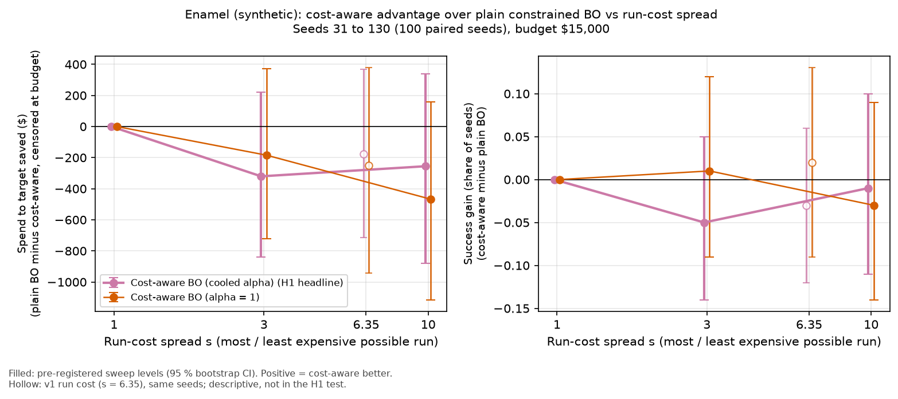

*Synthetic enamel simulator. Mean paired advantage of cost-aware BO over plain constrained BO across 100 seeds, 95 % bootstrap CIs; positive means cost-aware did better. Filled points are the pre-registered levels; hollow points are the v1 run cost (s = 6.35) on the same seeds, descriptive only.*

**The manipulation.** Run cost per trial is `k_s x (1 + (s - 1) x u(x))`, where `u` is v1's own variable run cost (a 40 kg trial batch at the recipe's material price, so pricier resin blends cost more, plus oven energy and time, so a hotter oven and a longer dwell cost more) rescaled to 0 to 1 over the allowed box. The most expensive possible run costs exactly s times the cheapest (exact, from the 32 corners of the box), and `k_s` keeps the mean run cost at the v1 value, so the $15,000 budget buys about 21 average runs at every level. At s = 1 every run costs the same, so cost-aware and plain BO must choose identically (a built-in control: all 100 seeds tie). The v1 run cost is the member of this family with s = 6.3465 (exact, from the box corners; v1's calibration file quoted 5.96 because it took the min and max of 200,000 random samples).

| Run-cost spread s | Cheapest possible run | Most expensive run | Mean over the box | Runs per budget at the mean |
|---|---|---|---|---|
| 1 | $711.48 | $711.48 | $711.48 | 21.1 |
| 3 | $469.30 | $1,407.90 | $711.48 | 21.1 |
| 10 | $214.16 | $2,141.57 | $711.48 | 21.1 |
| v1 formula (effective s = 6.3465) | $299.00 | $1,897.60 | $711.48 | 21.1 |

**Pre-registered test.** For each co-primary metric, H1 needed the per-seed growth A(10) - A(1) to have a 95 % CI above zero and the level means not to decrease; both metrics passing = supported. Spend-to-target means spend until the first truly in-spec recipe within 5 % of the cheapest possible cost, counted as the full budget when never reached (v1's rule).

- `bo_cost_cooled` (H1 headline): H1 **not supported**; cost-awareness starts to pay at: never within the tested range (s <= 10).
- `bo_cost` (secondary, not the verdict): H1 **not supported**; cost-awareness starts to pay at: never within the tested range (s <= 10).
- Seeds 31 to 130 (100), bootstrap 2,000 resamples (seed 0).

| Method | Metric | Mean advantage at s = 1, s = 3, s = 10 | Growth A(10) - A(1) [95 % CI] | Growth CI above 0 | Non-decreasing | Criterion met |
|---|---|---|---|---|---|---|
| `bo_cost_cooled` | spend to target saved ($, censored at budget) | 0 / -320 / -255 | -255 [-881, 338] | no | no | no |
| `bo_cost_cooled` | success gain (share of seeds) | 0.000 / -0.050 / -0.010 | -0.010 [-0.110, 0.100] | no | no | no |
| `bo_cost_cooled` | final regret reduction ($/kg) | 0.0000 / 0.0120 / 0.0437 | 0.0437 [-0.0244, 0.1145] | no | yes | no |
| `bo_cost` | spend to target saved ($, censored at budget) | 0 / -185 / -468 | -468 [-1,114, 157] | no | no | no |
| `bo_cost` | success gain (share of seeds) | 0.000 / 0.010 / -0.030 | -0.030 [-0.140, 0.090] | no | no | no |
| `bo_cost` | final regret reduction ($/kg) | 0.0000 / 0.0281 / 0.0178 | 0.0178 [-0.0616, 0.0921] | no | no | no |

The regret rows are secondary and play no part in the verdict.

Per-level paired advantages on the two co-primary metrics (all metrics, including regret, are in the tables file):

| s | Comparison | Advantage metric (positive = cost-aware better) | Mean [95 % CI] | CI above 0 | Seeds better / tied / worse |
|---|---|---|---|---|---|
| 1 | `bo_cost_cooled` vs `bo_plain` | spend to target saved ($, censored at budget) | 0 [0, 0] | no | 0 / 100 / 0 |
| 1 | `bo_cost_cooled` vs `bo_plain` | success gain (share of seeds) | 0.000 [0.000, 0.000] | no | 0 / 100 / 0 |
| 1 | `bo_cost` vs `bo_plain` | spend to target saved ($, censored at budget) | 0 [0, 0] | no | 0 / 100 / 0 |
| 1 | `bo_cost` vs `bo_plain` | success gain (share of seeds) | 0.000 [0.000, 0.000] | no | 0 / 100 / 0 |
| 3 | `bo_cost_cooled` vs `bo_plain` | spend to target saved ($, censored at budget) | -320 [-840, 222] | no | 18 / 61 / 21 |
| 3 | `bo_cost_cooled` vs `bo_plain` | success gain (share of seeds) | -0.050 [-0.140, 0.050] | no | 11 / 73 / 16 |
| 3 | `bo_cost` vs `bo_plain` | spend to target saved ($, censored at budget) | -185 [-722, 373] | no | 24 / 51 / 25 |
| 3 | `bo_cost` vs `bo_plain` | success gain (share of seeds) | 0.010 [-0.090, 0.120] | no | 16 / 69 / 15 |
| 10 | `bo_cost_cooled` vs `bo_plain` | spend to target saved ($, censored at budget) | -255 [-881, 338] | no | 25 / 53 / 22 |
| 10 | `bo_cost_cooled` vs `bo_plain` | success gain (share of seeds) | -0.010 [-0.110, 0.100] | no | 15 / 69 / 16 |
| 10 | `bo_cost` vs `bo_plain` | spend to target saved ($, censored at budget) | -468 [-1,114, 157] | no | 25 / 50 / 25 |
| 10 | `bo_cost` vs `bo_plain` | success gain (share of seeds) | -0.030 [-0.140, 0.090] | no | 16 / 65 / 19 |

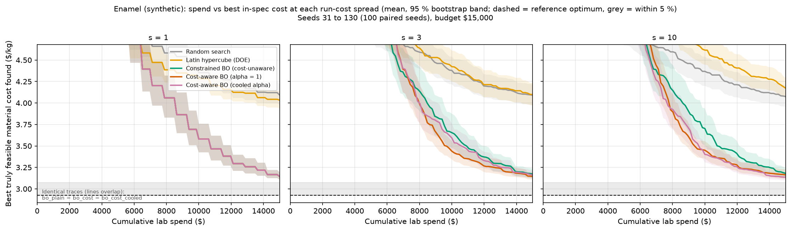

Mechanism check (descriptive): the cost-aware methods do pick cheaper runs as the spread grows, which is what dividing by run cost should do.

| s | Method | Success rate | Mean experiments | Mean $ per run | Median final regret ($/kg) |
|---|---|---|---|---|---|
| 1 | Random search (`random`) | 0.000 | 21.0 | $711 | 1.0222 |
| 1 | Latin hypercube (DOE) (`lhs`) | 0.000 | 21.0 | $711 | 1.1214 |
| 1 | Constrained BO (cost-unaware) (`bo_plain`) | 0.410 | 21.0 | $711 | 0.1828 |
| 1 | Cost-aware BO (alpha = 1) (`bo_cost`) | 0.410 | 21.0 | $711 | 0.1828 |
| 1 | Cost-aware BO (cooled alpha) (`bo_cost_cooled`) | 0.410 | 21.0 | $711 | 0.1828 |
| 3 | Random search (`random`) | 0.000 | 21.1 | $704 | 1.0222 |
| 3 | Latin hypercube (DOE) (`lhs`) | 0.000 | 20.3 | $730 | 1.0534 |
| 3 | Constrained BO (cost-unaware) (`bo_plain`) | 0.390 | 20.6 | $722 | 0.1850 |
| 3 | Cost-aware BO (alpha = 1) (`bo_cost`) | 0.400 | 21.0 | $707 | 0.1671 |
| 3 | Cost-aware BO (cooled alpha) (`bo_cost_cooled`) | 0.340 | 20.9 | $712 | 0.1772 |
| 10 | Random search (`random`) | 0.000 | 21.7 | $693 | 0.9918 |
| 10 | Latin hypercube (DOE) (`lhs`) | 0.010 | 20.3 | $735 | 1.2353 |
| 10 | Constrained BO (cost-unaware) (`bo_plain`) | 0.370 | 20.6 | $726 | 0.1855 |
| 10 | Cost-aware BO (alpha = 1) (`bo_cost`) | 0.340 | 22.1 | $676 | 0.1674 |
| 10 | Cost-aware BO (cooled alpha) (`bo_cost_cooled`) | 0.360 | 21.7 | $692 | 0.1652 |

Two secondary readings, both unadjusted and descriptive. The spend to the *first* in-spec recipe of any cost (the other way to read "reach spec") leans slightly toward cost-aware BO at s = 10, with intervals that include zero:

| s | Method (vs `bo_plain`) | S2 metric | Mean [95 % CI] | Seeds better / tied / worse |
|---|---|---|---|---|
| 1 | `bo_cost_cooled` | spend to first in-spec recipe saved ($) | 0 [0, 0] | 0 / 100 / 0 |
| 1 | `bo_cost` | spend to first in-spec recipe saved ($) | 0 [0, 0] | 0 / 100 / 0 |
| 3 | `bo_cost_cooled` | spend to first in-spec recipe saved ($) | 21 [-134, 186] | 8 / 84 / 8 |
| 3 | `bo_cost` | spend to first in-spec recipe saved ($) | 45 [-120, 210] | 10 / 84 / 6 |
| 10 | `bo_cost_cooled` | spend to first in-spec recipe saved ($) | 94 [-35, 241] | 11 / 84 / 5 |
| 10 | `bo_cost` | spend to first in-spec recipe saved ($) | 135 [-7, 301] | 12 / 83 / 5 |

One secondary interval out of more than a dozen sits just above zero (`bo_cost` final regret at the v1 run cost, 0.0566 [0.0001, 0.1169] $/kg, in [`reports/v2/analysis/v1_settings_advantage.csv`](reports/v2/analysis/v1_settings_advantage.csv)). With that many unadjusted intervals, one this marginal is expected by chance, so it is not claimed.

**Plain answer: within the range tested (the most expensive run up to 10 times the cheapest), cost-awareness never paid on this problem.** A likely reason (an interpretation, not a tested result): here run cost rises with material cost, which the acquisition already rewards, so dividing by run cost mostly re-weights candidates the plain method would have liked anyway, while shifting effort toward cheap runs in a way that does not find the cheapest in-spec recipe faster.

### Confirmatory test of fixed-alpha cost-aware BO (H2)

| Comparison (enamel, v1 settings) | Success rate, bo_cost | Success rate, bo_plain | Paired difference [95 % CI] | Seeds only bo_cost / only bo_plain succeeded | Exact McNemar p | Seeds | Replicated (CI above 0) |
|---|---|---|---|---|---|---|---|
| `bo_cost` minus `bo_plain` | 0.390 | 0.370 | 0.020 [-0.090, 0.130] | 19 / 17 | 0.868 | 100 | **no** |

Robustness re-check with 10,000 resamples (seed 1): H1 verdicts unchanged: yes; 'starts to pay' unchanged: yes; H2 verdict unchanged: yes.

**It did not replicate.** On seeds 0 to 29 v1 saw `bo_cost` beat plain BO on success by +0.233 [0.033, 0.433], but `bo_cost` was not the method chosen in advance, so that was a post-hoc observation. Tested as the pre-registered headline on 100 new seeds, the gain is 0.020 with a CI from -0.090 to 0.130: no evidence of a success advantage. With 100 seeds a true gain of about 0.18 would probably have been detected (pre-registration, section 5), so a large effect is unlikely, but a small one cannot be ruled out.

v1 settings on the new seeds, enamel (the H2 data):

| Method | Success rate [95 % Wilson CI] | Median spend-to-target [CI] | Median experiments-to-target | Mean final regret, $/kg [95 % CI] | Median final regret, $/kg [95 % CI] | Mean experiments | Lab's pick truly out of spec |
|---|---|---|---|---|---|---|---|
| Random search (`random`) | 0.000 [0.000, 0.037] | not reached (<= half of seeds) | n/a | 1.1429 [1.0274, 1.2750] | 0.9918 [0.8299, 1.1374] | 21.4 | 0.130 |
| Latin hypercube (DOE) (`lhs`) | 0.000 [0.000, 0.037] | not reached (<= half of seeds) | n/a | 1.2808 [1.1474, 1.4355] | 1.1917 [1.0223, 1.3050] | 20.2 | 0.160 |
| Fractional factorial (DOE) (`factorial`) | 0.000 [0.000, 0.037] | not reached (<= half of seeds) | n/a | 0.9946 [0.9835, 1.0026] | 1.0042 [1.0042, 1.0042] | 20.3 | 0.000 |
| Constrained BO (cost-unaware) (`bo_plain`) | 0.370 [0.282, 0.468] | not reached (<= half of seeds) | n/a | 0.2527 [0.2031, 0.3122] | 0.1855 [0.1576, 0.2017] | 20.7 | 0.150 |
| Cost-aware BO (alpha = 1) (`bo_cost`) | 0.390 [0.300, 0.488] | not reached (<= half of seeds) | n/a | 0.1961 [0.1707, 0.2276] | 0.1650 [0.1501, 0.1866] | 21.6 | 0.200 |
| Cost-aware BO (cooled alpha) (`bo_cost_cooled`) | 0.340 [0.255, 0.437] | not reached (<= half of seeds) | n/a | 0.2484 [0.1917, 0.3204] | 0.1710 [0.1571, 0.2014] | 21.2 | 0.210 |

### Concrete success against tolerance and budget (descriptive)

These curves add no new claims. They show how v1's concrete result depends on where the success line is drawn.

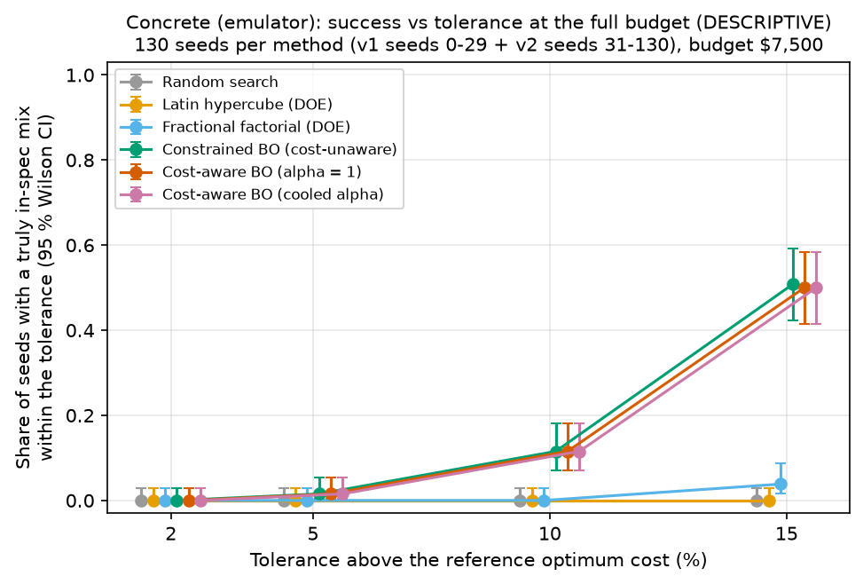
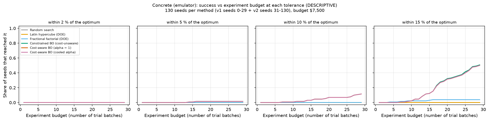

DESCRIPTIVE. 130 seeds per method (v1: seeds 0 to 29 (reports/v1); v2: seeds 31 to 130 (reports/v2/v1_settings)). Reference optimum 85.3996 $/m3; cheapest truly in-spec mix found by any campaign: 87.9483 $/m3. Success at the full budget (29 experiments max), Wilson 95 % CI, (successes / seeds).

| Method | within 2 % (<= 87.11 $/m3) | within 5 % (<= 89.67 $/m3) | within 10 % (<= 93.94 $/m3) | within 15 % (<= 98.21 $/m3) |
|---|---|---|---|---|
| Random search (`random`) | 0.000 [0.000, 0.029] (0/130) | 0.000 [0.000, 0.029] (0/130) | 0.000 [0.000, 0.029] (0/130) | 0.000 [0.000, 0.029] (0/130) |
| Latin hypercube (DOE) (`lhs`) | 0.000 [0.000, 0.029] (0/130) | 0.000 [0.000, 0.029] (0/130) | 0.000 [0.000, 0.029] (0/130) | 0.000 [0.000, 0.029] (0/130) |
| Fractional factorial (DOE) (`factorial`) | 0.000 [0.000, 0.029] (0/130) | 0.000 [0.000, 0.029] (0/130) | 0.000 [0.000, 0.029] (0/130) | 0.038 [0.017, 0.087] (5/130) |
| Constrained BO (cost-unaware) (`bo_plain`) | 0.000 [0.000, 0.029] (0/130) | 0.015 [0.004, 0.054] (2/130) | 0.115 [0.071, 0.182] (15/130) | 0.508 [0.423, 0.592] (66/130) |
| Cost-aware BO (alpha = 1) (`bo_cost`) | 0.000 [0.000, 0.029] (0/130) | 0.015 [0.004, 0.054] (2/130) | 0.115 [0.071, 0.182] (15/130) | 0.500 [0.415, 0.585] (65/130) |
| Cost-aware BO (cooled alpha) (`bo_cost_cooled`) | 0.000 [0.000, 0.029] (0/130) | 0.015 [0.004, 0.054] (2/130) | 0.115 [0.071, 0.182] (15/130) | 0.500 [0.415, 0.585] (65/130) |

| Method | Share of campaigns with any in-spec mix | Best campaign: % above optimum | Median campaign: % above optimum | Worst campaign: % above optimum |
|---|---|---|---|---|
| Random search (`random`) | 1.000 | 16.82 | 30.42 | 58.08 |
| Latin hypercube (DOE) (`lhs`) | 1.000 | 18.66 | 34.67 | 55.26 |
| Fractional factorial (DOE) (`factorial`) | 1.000 | 11.88 | 31.82 | 52.80 |
| Constrained BO (cost-unaware) (`bo_plain`) | 1.000 | 2.98 | 14.94 | 75.27 |
| Cost-aware BO (alpha = 1) (`bo_cost`) | 1.000 | 2.98 | 15.10 | 75.27 |
| Cost-aware BO (cooled alpha) (`bo_cost_cooled`) | 1.000 | 2.98 | 15.10 | 75.27 |

**What "0 percent success at 5 percent" means.** The cheapest mix that truly reaches 50 MPa costs 85.3996 $/m3 (found by 200,000 noise-free samples plus a local polish, something no lab can do). "Success at 5 %" means a campaign tested, within its $7,500 (29 trial batches), a mix that truly passes and costs at most 89.67 $/m3. In v1 no method did that in any of 30 seeds; on 130 seeds BO did it twice. It does **not** mean the methods found nothing usable: every campaign of every method found at least one truly in-spec mix, and the typical BO campaign's best mix was about 15 % above the cheapest possible one, against about 30 to 35 % for random search and the DOE plans. Loosen the line to 15 % and BO succeeds in about half of the seeds while random search and Latin hypercube still never do. The target at 5 % sits in a thin sliver of the design space; the 5 % line is simply too tight for 29 noisy experiments on this emulator.

v1 settings on the new seeds, concrete:

| Method | Success rate [95 % Wilson CI] | Median spend-to-target [CI] | Median experiments-to-target | Mean final regret, $/m3 [95 % CI] | Median final regret, $/m3 [95 % CI] | Mean experiments | Lab's pick truly out of spec |
|---|---|---|---|---|---|---|---|
| Random search (`random`) | 0.000 [0.000, 0.037] | not reached (<= half of seeds) | n/a | 26.0695 [24.9403, 27.1719] | 25.4825 [24.1545, 26.8730] | 29.0 | 0.520 |
| Latin hypercube (DOE) (`lhs`) | 0.000 [0.000, 0.037] | not reached (<= half of seeds) | n/a | 30.1837 [28.7532, 31.5291] | 29.1716 [28.3894, 31.1420] | 29.0 | 0.480 |
| Fractional factorial (DOE) (`factorial`) | 0.000 [0.000, 0.037] | not reached (<= half of seeds) | n/a | 27.1225 [25.5266, 28.8037] | 28.1123 [24.6381, 30.1592] | 29.0 | 0.360 |
| Constrained BO (cost-unaware) (`bo_plain`) | 0.020 [0.006, 0.070] | not reached (<= half of seeds) | n/a | 18.2228 [15.6808, 21.0926] | 12.3161 [11.4047, 13.4331] | 29.0 | 0.730 |
| Cost-aware BO (alpha = 1) (`bo_cost`) | 0.020 [0.006, 0.070] | not reached (<= half of seeds) | n/a | 18.4026 [15.8309, 21.2217] | 12.3161 [11.4047, 13.4599] | 29.0 | 0.730 |
| Cost-aware BO (cooled alpha) (`bo_cost_cooled`) | 0.020 [0.006, 0.070] | not reached (<= half of seeds) | n/a | 18.4026 [15.8309, 21.2217] | 12.3161 [11.4047, 13.4599] | 29.0 | 0.730 |

On these new seeds the three BO variants no longer chose identical experiments in every seed (they did on v1's seeds 0 to 29), but their summaries are nearly the same, as expected when run cost varies by only about 2 %.

### Lab-note risk label computed in code

The risk label is now computed in code from the probability of passing all specs, with thresholds in `config.yaml` (`lab_note.risk_thresholds`: below 0.5 High, 0.5 to below 0.8 Medium, 0.8 or above Low). The LLM only writes sentences around the label and numbers it is given. `formopt.llm.validate_lab_note` rejects any note whose label differs, that does not quote the pass probability, that uses another label word in its risk sentence, or that contains a number not among the supplied facts; after one retry, a template note built only from the facts is used. Offline tests use a mocked LLM. The live check with `qwen3:14b` on the same suggestion as the v1 example (30.5 % chance of passing all specs) got the computed label High, and the model's note passed validation on its first attempt in 37.8 s ([`reports/v2/lab_note_check_enamel.json`](reports/v2/lab_note_check_enamel.json)). The v1 example had called this suggestion "Low" risk.

### Batch suggestions (exploratory, dev seeds only)

A q = 4 kriging-believer mode plans four experiments per oven cycle: pick the best candidate, pretend the lab measured the GP's prediction there, update the GP, pick again.

EXPLORATORY, dev seeds 1001 to 1010 only, q = 4, enamel at v1 settings, budget $15,000.

| Method | Success rate [95 % Wilson CI] | Mean final regret, $/kg [95 % CI] | Mean experiments | Mean oven cycles | Mean wall time per campaign (s) |
|---|---|---|---|---|---|
| `bo_plain` | 0.400 [0.168, 0.687] | 0.2806 [0.1695, 0.4022] | 20.8 | 20.8 | 3.7 |
| `bo_plain_q4` | 0.400 [0.168, 0.687] | 0.1807 [0.1266, 0.2372] | 21.2 | 6.2 | 1.3 |
| `bo_cost_cooled` | 0.300 [0.108, 0.603] | 0.1669 [0.1426, 0.1947] | 21.0 | 21.0 | 3.8 |
| `bo_cost_cooled_q4` | 0.400 [0.168, 0.687] | 0.2055 [0.1134, 0.3421] | 21.4 | 6.3 | 1.3 |

Ten dev seeds cannot separate these methods (the intervals overlap widely). The one clear number is the oven cycles: about 6 instead of about 21 for the same budget, which matters when calendar time is the constraint. A proper comparison would need pre-registered reporting seeds.

### Reproduce v2 (Windows PowerShell)

```powershell
# Constants of the run-cost family and the v1 effective spread (no runs, a second)
uv run python -m formopt run-cost-spread

# v1 still reproduces with default settings: rerun into a scratch folder, compare exactly
uv run python -m formopt benchmark --problem enamel concrete --seeds 30 --n-jobs 6 --no-mlflow --out-dir reports/v2/v1_repro
uv run python -m formopt repro-check --candidate reports/v2/v1_repro

# Dev-seed timing runs (seeds 1001 to 1010) and the runtime estimate
uv run python -m formopt v2-run --what sweep --dev
uv run python -m formopt v2-run --what v1-settings --dev
uv run python -m formopt runtime-estimate

# Pre-registered reporting runs, seeds 31 to 130 (about 11 + 16 min with 6 workers here)
uv run python -m formopt v2-run --what sweep          # spread sweep: s = 1, 3, 10
uv run python -m formopt v2-run --what v1-settings    # H2 and concrete-curve data

# Analysis, figures and tables
uv run python -m formopt v2-analyze                   # H1, H2, robustness, sweep figures
uv run python -m formopt tolerance-curves             # concrete curves (descriptive)
uv run python -m formopt batch-compare                # batch mode (exploratory, dev seeds)
uv run --group llm python -m formopt lab-note         # live lab-note check (needs Ollama)
uv run python scripts/report_tables_v2.py             # reports\v2\tables_v2.md

# One spread level by hand
uv run python -m formopt benchmark --problem enamel --run-cost-spread 10 --seed-start 31 --seeds 100 --n-jobs 6 --out-dir reports/v2/my_s10
```

## Approach

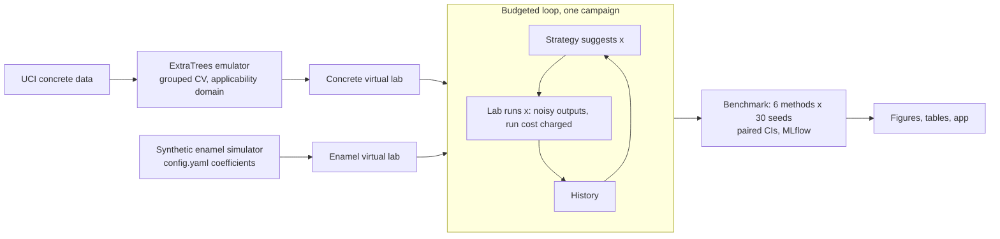

**Two virtual labs.**

- **Magnet wire enamel (SYNTHETIC).** An illustrative simulator, plausible in direction and order of magnitude but **not calibrated to any real enamel or any company's products**. Five inputs (PAI fraction of the resin blend, solids %, catalyst phr, cure oven temperature, line speed), three specs (breakdown proxy at least 30, flexibility pass rate at least 0.8 out of 5 mandrel wraps, viscosity 2,000 to 15,000 cP), a known oven limit of 560 C, and a known material cost and run cost. Cure is an Arrhenius rate times residence time, so oven temperature and line speed interact. It was calibrated against fixed rules and frozen before any method comparison: 25.8 % of the allowed box is truly feasible, run costs span $312 to $1,859 (5.96x), and two specs are active at the optimum ([`reports/v1/calibration_enamel.json`](reports/v1/calibration_enamel.json)). Ranges for solids, viscosity and oven zones come from US Patent 4,374,221; everything else is illustrative.
- **Concrete (real data, emulated).** An ExtraTrees model trained on all 1,005 clean rows of the UCI Concrete Compressive Strength data (age as an input) acts as the lab, with noise equal to its cross-validated residual sd capped at 5 MPa. It is deliberately not a GP, so the optimizer's surrogate cannot share its inductive bias. Known constraints keep candidates physically meaningful: each ingredient within its observed range, total mass and water-to-binder ratio within observed ranges, and a kNN applicability domain around real mixes. The spec is 28-day strength of at least 50 MPa: the documented 40 MPa default made 53.7 % of the allowed region feasible, far above the 5 to 35 % calibration rule, while 50 MPa gives 25.9 % (target sweep and final 25.8 % in [`reports/v1/calibration_concrete.json`](reports/v1/calibration_concrete.json)). Prices are USGS 2025 national averages for cement, slag and aggregates, and **assumptions** for fly ash, water and superplasticizer.

**Methods compared (same budget, same cost accounting, common random numbers for noise).** Uniform random search; Latin hypercube planned up front; 2-level fractional factorial at 20/80 % levels plus centre points (then an LHS fill); constrained BO that ignores run cost (`bo_plain`); cost-aware BO with alpha = 1 (`bo_cost`); cost-aware BO with alpha cooled from 1 to 0 over the budget (`bo_cost_cooled`, the headline, chosen on dev seeds 1000 to 1009 before the reporting run).

**How the BO picks the next experiment.** After each run it fits one Gaussian process (Matern 5/2, one length scale per input, learned noise) per measured output, never for cost, because cost is a known formula. It samples 4,000 candidates that pass the known constraints and scores each one:

```
score(x) = max(best_passed_cost - material_cost(x), 0) * PoF(x) / run_cost(x) ** alpha
```

`PoF(x)` is the probability that the recipe passes every spec, the product of one Gaussian tail probability per spec. Because material cost is known exactly, this improvement times PoF is what constrained expected improvement reduces to. Before any recipe has passed, the score is just PoF per unit cost. With alpha = 0 it is standard constrained BO. With alpha = 1 it is "improvement per dollar of lab spend". Cooling alpha to 0 lets late, expensive but promising runs win. Candidates the remaining budget cannot pay for are dropped.

## v1 results (seeds 0 to 29, unchanged from v1)

Everything in this section is the v1 result as published, with file links updated to `reports/v1/`, where the v1 outputs now live unchanged. v2 reproduced these files exactly (see above). Where v2 adds to a v1 conclusion, a short note says so.

### v1 headline result

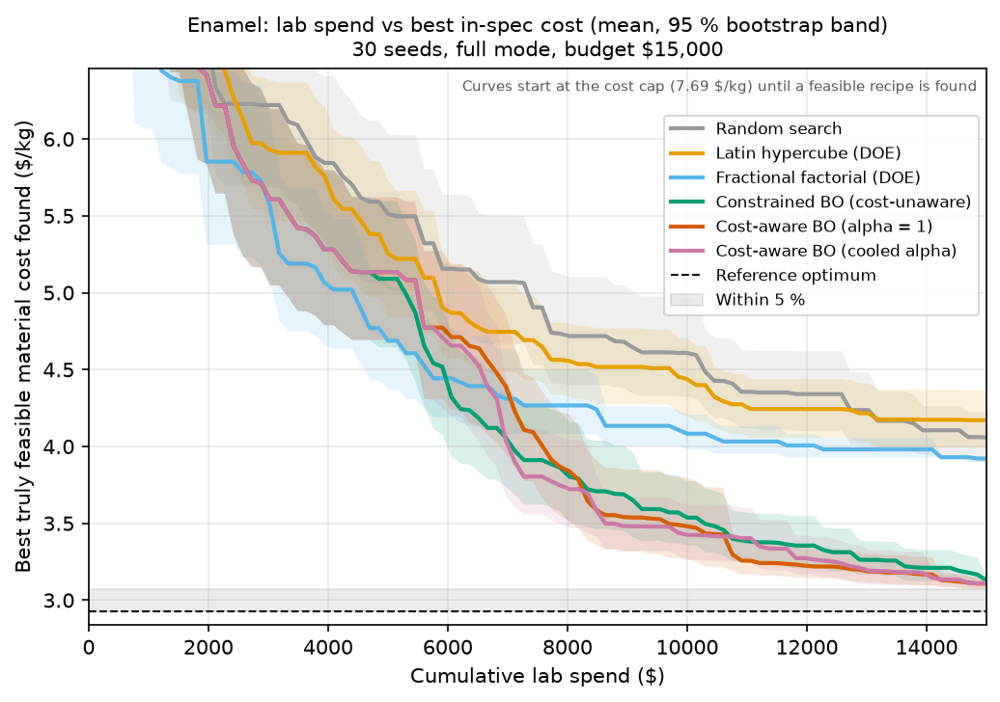

*Synthetic magnet wire enamel problem (simulator, not a real product). Mean over 30 paired seeds, 95 % bootstrap bands, full benchmark mode. Dashed line: true cheapest feasible cost; grey band: within 5 %.*

- **BO finds near-optimal in-spec recipes; random search and DOE do not.** On the synthetic enamel problem ($15,000 budget, 30 seeds), the headline cost-aware BO (`bo_cost_cooled`) found a truly in-spec recipe within 5 % of the cheapest possible cost in a **0.400 share of seeds (12 of 30) [95 % Wilson CI 0.246, 0.577]**; random search, Latin hypercube and fractional factorial did so in **0 of 30 seeds each** [0.000, 0.114]. Median final regret (cost above the true optimum of $2.9258/kg) was **$0.1572/kg** [0.1347, 0.1805] for cost-aware BO versus $1.0958/kg [0.8216, 1.3126] for random search.
- **Cost-awareness itself: no demonstrated win over plain BO.** The paired difference in spend-to-target between `bo_cost_cooled` and cost-unaware constrained BO is **-$436 [-1,653, +745]**: the confidence interval includes zero. The fixed-alpha variant `bo_cost` did better on the reporting seeds (success 0.500, paired success gain over plain BO +0.233 [0.033, 0.433]), but it was not the method chosen in advance on the dev seeds, so it is reported, not promoted. **v2 tested it on 100 new seeds and it did not replicate** (H2 above).
- **Same method on real concrete data.** On an emulator trained on the UCI concrete dataset (grouped-CV R2 0.8757), BO reached a median final regret of **$18.5259/m3** [12.9589, 25.1045] versus $27.5354/m3 [25.4932, 30.1337] for random search and $29.9674/m3 [28.7190, 33.6098] for Latin hypercube (non-overlapping CIs). No method came within 5 % of the optimum in 29 runs. A price-shock analysis re-optimizes for new prices with zero new experiments.

Every number in this README comes from files in `reports/v1/` written by the code (tables generated by `scripts/report_tables.py` into `reports/v1/tables.md`) and from the MLflow runs. All benchmark numbers are from the **full run: 30 seeds (0 to 29), 4,000 candidates per BO step**, not the quick mode.


### Enamel (synthetic simulator)

Run: 30 seeds (0 to 29), full mode (4,000 candidates per BO step), budget $15,000, reference optimum 2.9258 $/kg, target <= 3.0721. Wall time 64 s with n_jobs = 6; sum of per-campaign times 345 s (about the n_jobs = 1 runtime).

| Method | Success rate [95 % Wilson CI] | Median spend-to-target [CI] | Median experiments-to-target | Mean final regret, $/kg [95 % CI] | Median final regret, $/kg [95 % CI] | Mean experiments | Lab's pick truly out of spec |
|---|---|---|---|---|---|---|---|
| Random search (`random`) | 0.000 [0.000, 0.114] | not reached (<= half of seeds) | n/a | 1.1332 [0.9694, 1.3024] | 1.0958 [0.8216, 1.3126] | 21.0 | 0.100 |
| Latin hypercube (DOE) (`lhs`) | 0.000 [0.000, 0.114] | not reached (<= half of seeds) | n/a | 1.2450 [1.0638, 1.4409] | 1.2975 [0.9770, 1.6068] | 20.2 | 0.100 |
| Fractional factorial (DOE) (`factorial`) | 0.000 [0.000, 0.114] | not reached (<= half of seeds) | n/a | 0.9957 [0.9788, 1.0042] | 1.0042 [1.0042, 1.0042] | 20.3 | 0.000 |
| Constrained BO (cost-unaware) (`bo_plain`) | 0.267 [0.142, 0.444] | not reached (<= half of seeds) | n/a | 0.2042 [0.1716, 0.2390] | 0.1903 [0.1674, 0.2310] | 20.9 | 0.267 |
| Cost-aware BO (alpha = 1) (`bo_cost`) | 0.500 [0.332, 0.668] | not reached (<= half of seeds) | n/a | 0.1817 [0.1451, 0.2258] | 0.1462 [0.1310, 0.1828] | 21.7 | 0.167 |
| Cost-aware BO (cooled alpha) (`bo_cost_cooled`) | 0.400 [0.246, 0.577] | not reached (<= half of seeds) | n/a | 0.1846 [0.1485, 0.2210] | 0.1572 [0.1347, 0.1805] | 21.5 | 0.133 |

"Lab's pick truly out of spec" is the share of seeds where the lab's own cheapest *passing* recipe (judged on the noisy measurement) actually fails spec on the noise-free truth. Success and regret are always judged on the truth.

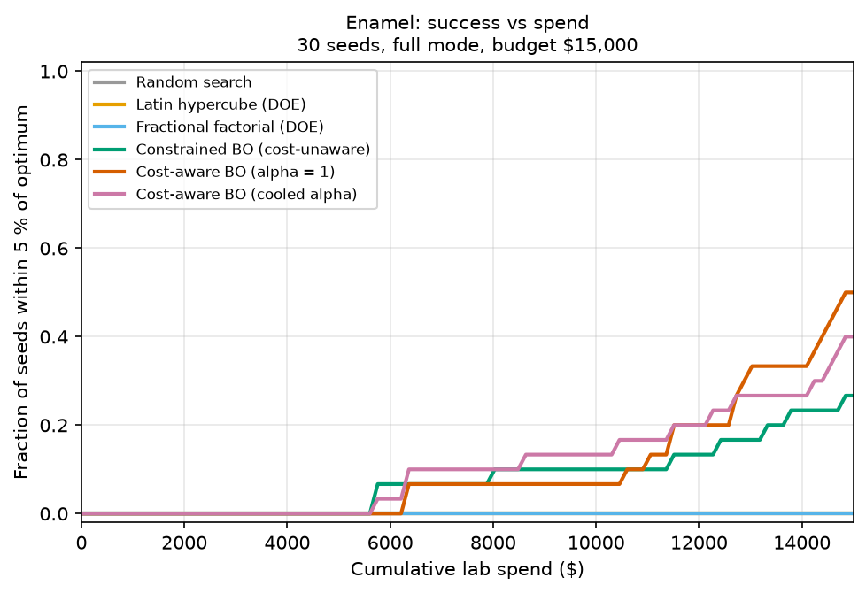 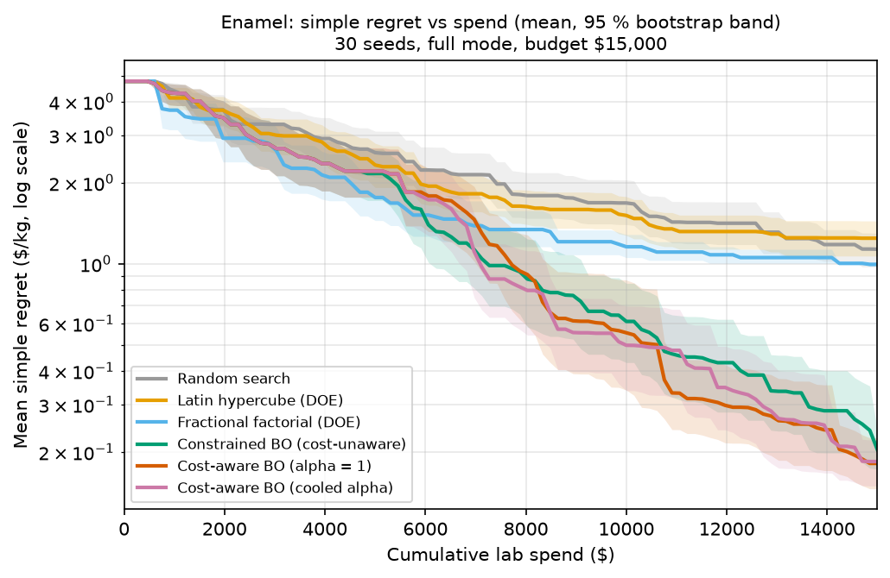

**Paired differences** (per seed: cost-aware BO minus the other method; 95 % bootstrap CI of the mean). Spend-to-target is censored at the budget for seeds that never reach the target.

| Comparison | Metric | Mean paired difference [95 % CI] | CI excludes 0 | Seeds a better / tied / total |
|---|---|---|---|---|
| `bo_cost_cooled` minus `random` | final regret ($/kg) | -0.9486 [-1.1138, -0.7842] | yes | 30 / 0 / 30 |
| `bo_cost_cooled` minus `random` | spend-to-target ($, censored at budget) | -1,608 [-2,763, -638] | yes | 12 / 18 / 30 |
| `bo_cost_cooled` minus `random` | success (0/1) | 0.400 [0.233, 0.567] | yes | 12 / 18 / 30 |
| `bo_cost_cooled` minus `lhs` | final regret ($/kg) | -1.0604 [-1.2529, -0.8769] | yes | 30 / 0 / 30 |
| `bo_cost_cooled` minus `lhs` | spend-to-target ($, censored at budget) | -1,608 [-2,763, -638] | yes | 12 / 18 / 30 |
| `bo_cost_cooled` minus `lhs` | success (0/1) | 0.400 [0.233, 0.567] | yes | 12 / 18 / 30 |
| `bo_cost_cooled` minus `factorial` | final regret ($/kg) | -0.8112 [-0.8504, -0.7704] | yes | 30 / 0 / 30 |
| `bo_cost_cooled` minus `factorial` | spend-to-target ($, censored at budget) | -1,608 [-2,763, -638] | yes | 12 / 18 / 30 |
| `bo_cost_cooled` minus `factorial` | success (0/1) | 0.400 [0.233, 0.567] | yes | 12 / 18 / 30 |
| `bo_cost_cooled` minus `bo_plain` | final regret ($/kg) | -0.0196 [-0.0660, 0.0251] | no | 18 / 2 / 30 |
| `bo_cost_cooled` minus `bo_plain` | spend-to-target ($, censored at budget) | -436 [-1,653, 745] | no | 8 / 17 / 30 |
| `bo_cost_cooled` minus `bo_plain` | success (0/1) | 0.133 [-0.067, 0.333] | no | 7 / 20 / 30 |
| `bo_cost_cooled` minus `bo_cost` | final regret ($/kg) | 0.0029 [-0.0278, 0.0320] | no | 8 / 11 / 30 |
| `bo_cost_cooled` minus `bo_cost` | spend-to-target ($, censored at budget) | -125 [-929, 600] | no | 7 / 14 / 30 |
| `bo_cost_cooled` minus `bo_cost` | success (0/1) | -0.100 [-0.300, 0.100] | no | 4 / 19 / 30 |

The fixed-alpha variant against plain BO:

| Comparison | Metric | Mean paired difference [95 % CI] | CI excludes 0 | Seeds a better / tied / total |
|---|---|---|---|---|
| `bo_cost` minus `bo_plain` | final regret ($/kg) | -0.0225 [-0.0599, 0.0138] | no | 15 / 3 / 30 |
| `bo_cost` minus `bo_plain` | spend-to-target ($, censored at budget) | -311 [-1,594, 972] | no | 12 / 13 / 30 |
| `bo_cost` minus `bo_plain` | success (0/1) | 0.233 [0.033, 0.433] | yes | 10 / 17 / 30 |

Reading: both cost-aware variants beat random search, LHS and the fractional factorial on every metric with CIs excluding zero. Against plain constrained BO, the headline method's differences all include zero. `bo_cost` has a success gain whose CI excludes zero, but its regret and spend differences include zero, and choosing it after seeing these seeds would be tuning on the test set. On dev seeds the ordering of `bo_cost` and `bo_cost_cooled` was reversed, and success rates moved between 0.1 and 0.7 across settings: the 5 % success threshold is a noisy metric with 10 seeds, which is why the reporting run uses 30 paired seeds.

**What the surrogate learned.** GP slices through the median headline campaign's best recipe (seed 16, 21 experiments) and probability of feasibility over oven temperature and line speed. The curved ridge in the heatmap is the temperature-speed interaction (hotter ovens need faster lines):

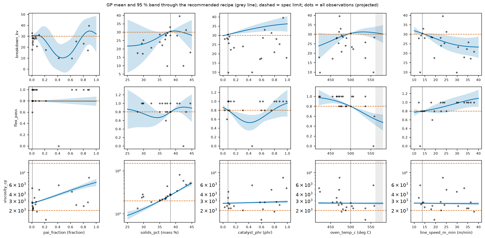
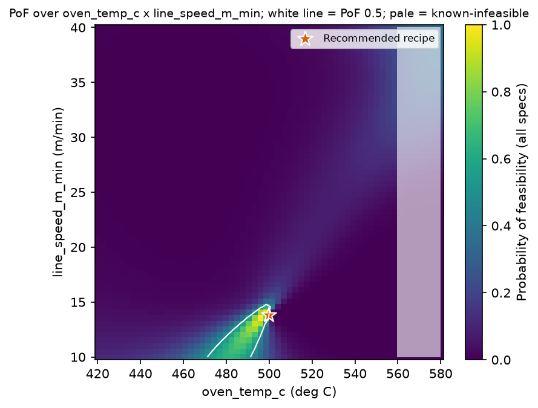

### Concrete (emulator trained on real UCI data)

Run: 30 seeds (0 to 29), full mode (4,000 candidates per BO step), budget $7,500, reference optimum 85.3996 $/m3, target <= 89.6696. Wall time 147 s with n_jobs = 6; sum of per-campaign times 842 s (about the n_jobs = 1 runtime).

| Method | Success rate [95 % Wilson CI] | Median spend-to-target [CI] | Median experiments-to-target | Mean final regret, $/m3 [95 % CI] | Median final regret, $/m3 [95 % CI] | Mean experiments | Lab's pick truly out of spec |
|---|---|---|---|---|---|---|---|
| Random search (`random`) | 0.000 [0.000, 0.114] | not reached (<= half of seeds) | n/a | 27.3343 [25.1170, 29.5533] | 27.5354 [25.4932, 30.1337] | 29.0 | 0.600 |
| Latin hypercube (DOE) (`lhs`) | 0.000 [0.000, 0.114] | not reached (<= half of seeds) | n/a | 30.9890 [28.6986, 33.3529] | 29.9674 [28.7190, 33.6098] | 29.0 | 0.367 |
| Fractional factorial (DOE) (`factorial`) | 0.000 [0.000, 0.114] | not reached (<= half of seeds) | n/a | 26.4679 [24.0379, 28.8756] | 25.9765 [24.1078, 28.7146] | 29.0 | 0.333 |
| Constrained BO (cost-unaware) (`bo_plain`) | 0.000 [0.000, 0.114] | not reached (<= half of seeds) | n/a | 22.1788 [17.8059, 27.0276] | 18.5259 [12.9589, 25.1045] | 29.0 | 0.833 |
| Cost-aware BO (alpha = 1) (`bo_cost`) | 0.000 [0.000, 0.114] | not reached (<= half of seeds) | n/a | 22.1788 [17.8059, 27.0276] | 18.5259 [12.9589, 25.1045] | 29.0 | 0.833 |
| Cost-aware BO (cooled alpha) (`bo_cost_cooled`) | 0.000 [0.000, 0.114] | not reached (<= half of seeds) | n/a | 22.1788 [17.8059, 27.0276] | 18.5259 [12.9589, 25.1045] | 29.0 | 0.833 |

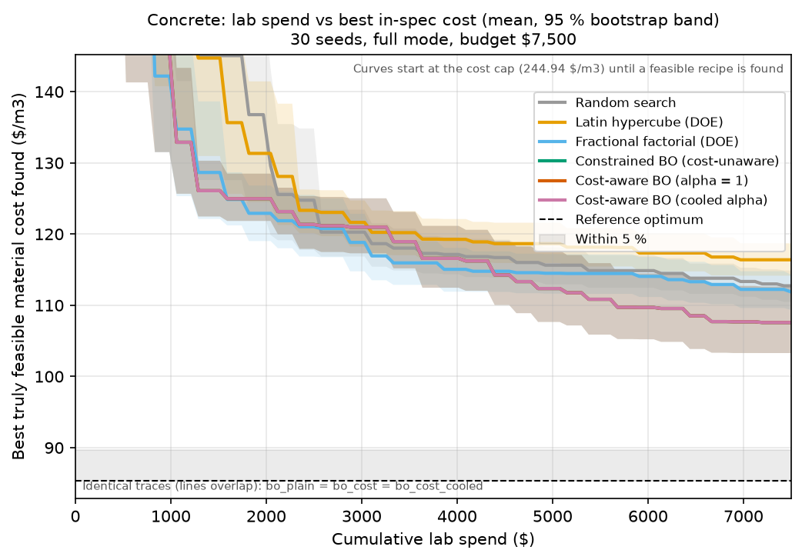

Paired final-regret differences (headline BO minus each baseline; all three BO variants made identical choices on every seed):

| Comparison | Metric | Mean paired difference [95 % CI] | CI excludes 0 | Seeds a better / tied / total |
|---|---|---|---|---|
| `bo_cost_cooled` minus `random` | final regret ($/m3) | -5.1555 [-10.3992, 0.6434] | no | 21 / 0 / 30 |
| `bo_cost_cooled` minus `lhs` | final regret ($/m3) | -8.8102 [-13.7072, -3.8468] | yes | 23 / 0 / 30 |
| `bo_cost_cooled` minus `factorial` | final regret ($/m3) | -4.2891 [-9.1983, 1.0498] | no | 21 / 0 / 30 |

Reading: BO lowers the median regret with non-overlapping CIs against random search and LHS (the project's target), although against random search the gap between the intervals is small and the paired mean difference includes zero. **No method reached the 5 % target on concrete**: the reference optimum ($85.40/m3) sits in a thin region; even the best of 200,000 uniform samples was only just inside the band. As expected, the run cost hardly varies across mixes (2 %) and rises with material cost, which the score already rewards, so cost-aware and plain BO picked exactly the same experiments: cost-awareness did no harm when it had nothing to exploit. A warning sign worth knowing: with 5 MPa noise and BO pushing recipes toward the 50 MPa boundary, the lab's own best "passing" mix was truly out of spec in 83 % of BO campaigns. See [Next steps](#next-steps).

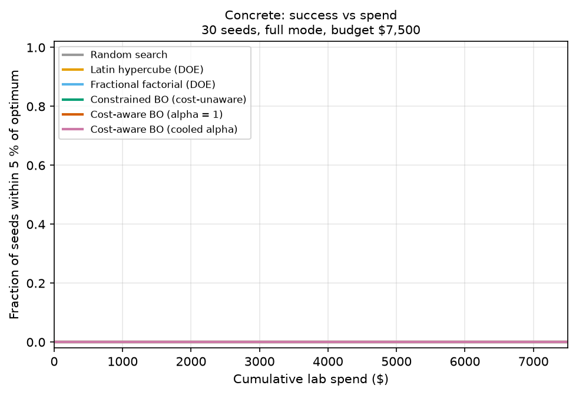 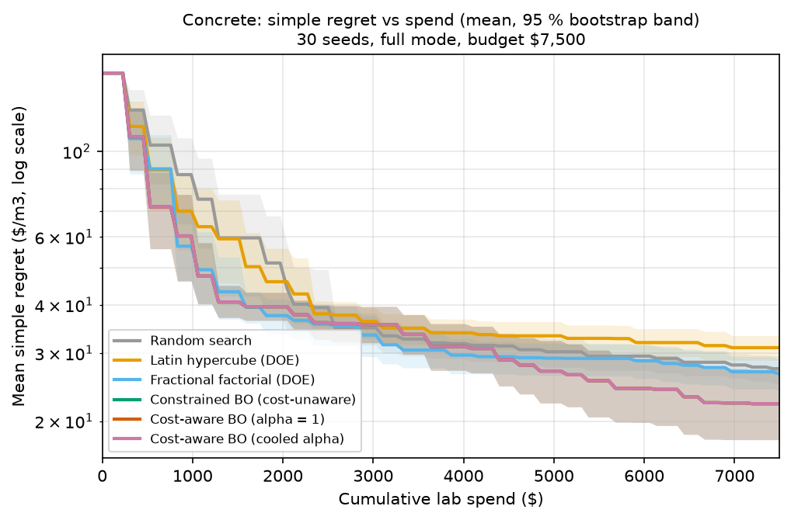

**Emulator validation** ([`reports/v1/emulator_validation.json`](reports/v1/emulator_validation.json)); target grouped-CV R2 at least 0.85: met.

| Emulator | Grouped-CV R2 | RMSE (MPa) | MAE (MPa) |
|---|---|---|---|
| `extra_trees` (chosen) | 0.8757 | 5.7392 | 4.1031 |
| `hist_gb` | 0.8594 | 6.1039 | 4.2735 |

Grouped 5-fold CV by mix_id on 1,005 rows (427 mixes, 25 exact duplicates dropped). Lab noise sd used in the problem: 5.0 MPa (CV residual sd 5.726, capped). Strength non-decreasing 7 to 28 to 90 days for 7 of 10 random mixes; partial dependence on w/b decreasing on 8 of 8 steps.

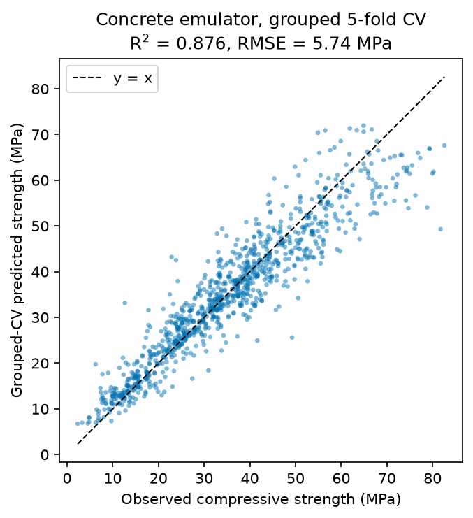

### Price shock: re-optimize with zero new experiments

The property models do not depend on prices, so a price change only changes the known cost formula. `price-shock` refits the GPs on one finished campaign (the median `bo_cost_cooled` campaign) and recommends the cheapest of 50,000 known-feasible candidates with PoF at least 0.8, under old and new prices.

**enamel: pai_resin x1.25.** GPs refit on 21 experiments of `bo_cost_cooled` seed 16 (30 seeds, full mode, budget $15,000); 0 new experiments; recommend the cheapest of 50,000 candidates with PoF >= 0.8. Old recipe at new prices costs 3.2455 $/kg.

| Scenario | Recommended recipe | Material cost ($/kg) | PoF | Truly in spec (simulator check) | True cheapest feasible ($/kg) |
|---|---|---|---|---|---|
| old prices | pai_fraction 0.00333, solids_pct 36.7, catalyst_phr 0.636, oven_temp_c 477, line_speed_m_min 11.8 | 3.2412 | 0.940 | yes | 2.9258 |
| new prices | pai_fraction 0.00333, solids_pct 36.7, catalyst_phr 0.636, oven_temp_c 477, line_speed_m_min 11.8 | 3.2455 | 0.940 | yes | 2.9258 |

**enamel: solvent x1.4.** GPs refit on 21 experiments of `bo_cost_cooled` seed 16 (30 seeds, full mode, budget $15,000); 0 new experiments; recommend the cheapest of 50,000 candidates with PoF >= 0.8. Old recipe at new prices costs 3.6967 $/kg.

| Scenario | Recommended recipe | Material cost ($/kg) | PoF | Truly in spec (simulator check) | True cheapest feasible ($/kg) |
|---|---|---|---|---|---|
| old prices | pai_fraction 0.00333, solids_pct 36.7, catalyst_phr 0.636, oven_temp_c 477, line_speed_m_min 11.8 | 3.2412 | 0.940 | yes | 2.9258 |
| new prices | pai_fraction 0.00333, solids_pct 36.7, catalyst_phr 0.636, oven_temp_c 477, line_speed_m_min 11.8 | 3.6967 | 0.940 | yes | 3.3925 |

**concrete: cement x1.3.** GPs refit on 29 experiments of `bo_cost_cooled` seed 11 (30 seeds, full mode, budget $7,500); 0 new experiments; recommend the cheapest of 50,000 candidates with PoF >= 0.8. Old recipe at new prices costs 101.8618 $/m3.

| Scenario | Recommended recipe | Material cost ($/m3) | PoF | Truly in spec (simulator check) | True cheapest feasible ($/m3) |
|---|---|---|---|---|---|
| old prices | cement 238, slag 1.59, fly_ash 139, water 128, superplasticizer 8.01, coarse_agg 987, fine_agg 834 | 90.4261 | 0.801 | no | 85.3996 |
| new prices | cement 238, slag 1.59, fly_ash 139, water 128, superplasticizer 8.01, coarse_agg 987, fine_agg 834 | 101.8618 | 0.801 | no | 96.6065 |

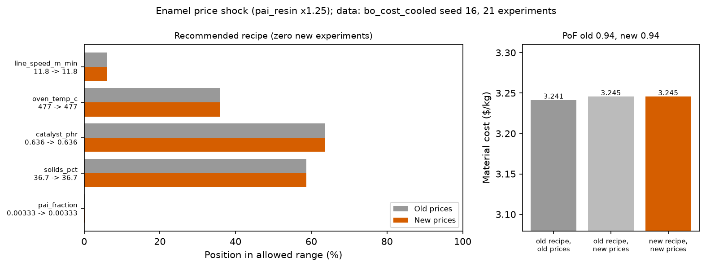

Reading: in all three cases the recommended recipe did not move; only its cost did. In the enamel simulator the true cheapest recipe is pinned by constraints (no PAI, no catalyst, solids at the viscosity floor). The model's recommendation already has almost no PAI (0.00333), so a PAI price rise barely matters, and a solvent rise raises every candidate's cost while the same candidate stays cheapest. The recommendation costs more than the true optimum (3.2412 vs 2.9258 $/kg) because, after 21 experiments, the model is only confident (PoF >= 0.8) in a region that uses 0.636 phr catalyst. I checked this is not a bug: the ranking of the next-best candidates does change, the top one stays cheapest. The true cheapest feasible cost moves as the "True cheapest" column shows. On concrete the model's recommendation (PoF 0.801) is truly out of spec when checked against the emulator truth: the surrogate is overconfident near the strength boundary (next section). See [`price_shock_enamel_solvent.png`](reports/v1/figures/price_shock_enamel_solvent.png) and [`price_shock_concrete.png`](reports/v1/figures/price_shock_concrete.png).

### Surrogate calibration

Target: 85 to 99 % of measurements inside the GP's 95 % predictive interval.

| Output | In-loop next-point 95 % coverage (all BO campaigns) | Mean z | Hold-out 95 % coverage (25 LHS points, 500 test, 5 seeds) |
|---|---|---|---|
| enamel `breakdown_kv` | 0.647 (n = 1381) | -1.86 | 0.875 |
| enamel `flex_pass` | 0.743 (n = 1381) | -2.64 | 0.787 |
| enamel `viscosity_cp` | 0.839 (n = 1381) | -0.19 | 0.913 |
| concrete `strength_mpa` | 0.528 (n = 2070) | -2.69 | 0.712 |

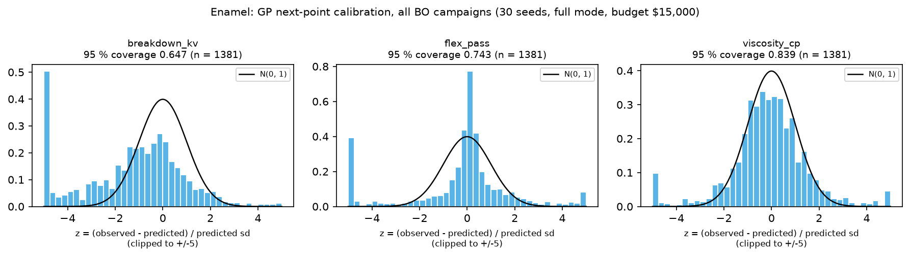

**Target missed.** On random hold-out points, breakdown and viscosity are calibrated; flexibility (a discrete binomial measurement) and concrete (a piecewise-constant tree-ensemble truth) are overconfident. At the points BO actually chooses, every output is overconfident and measurements come in below the prediction on average (negative mean z). That is a selection effect: BO runs points where the model is optimistic, at spec boundaries. Capping the GP length-scale upper bound at 10 instead of 100 improved hold-out coverage for breakdown and viscosity (investigation in `PROGRESS.md`); a higher GP noise floor was tried on dev seeds and made the headline optimizer worse ([`reports/v1/dev/variants/`](reports/v1/dev/variants/)), so it was not adopted.

### The app

`uv run streamlit run app/streamlit_app.py` opens a decision tool: pick a scenario, set specs, budget, prices and run cost model, get the suggested experiment with predicted outputs and 95 % intervals, the probability of passing each spec, the run cost and a rough estimate of the spend to the next in-spec result; run it on the simulator or type in a lab result; see GP slices, a PoF heatmap, the spend chart, the benchmark and a price-shock view. A suggestion takes a median of 0.247 s on enamel and 0.113 s on concrete with 4,000 candidates ([`reports/v1/suggestion_latency.json`](reports/v1/suggestion_latency.json); target under 2 s).

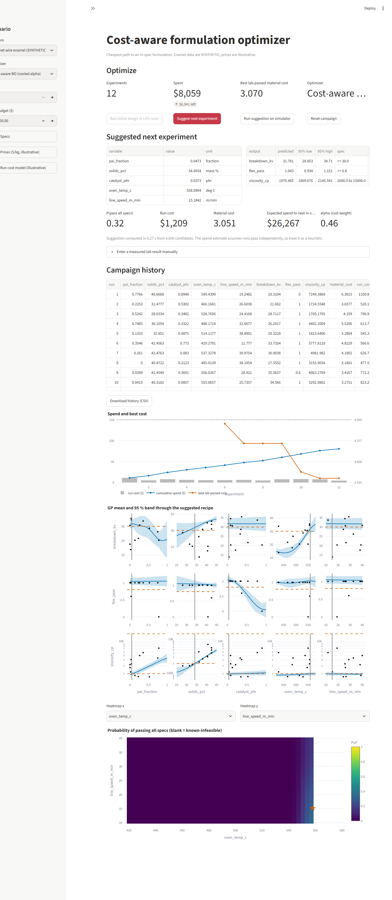

More: [benchmark view](reports/v1/figures/app_benchmark_enamel.png), [price-shock view](reports/v1/figures/app_price_shock_enamel.png), [about](reports/v1/figures/app_about.png).

### Local-LLM lab note (optional)

`uv sync --group llm` then `uv run python -m formopt lab-note` sends the facts of one suggestion (recipe, predicted outputs with 95 % ranges, pass probabilities, costs) to a local model through Ollama's OpenAI-compatible API and gets back a schema-validated JSON lab note, with one retry on invalid JSON. Example from `qwen3:14b` in [`reports/v1/lab_note_example_enamel.json`](reports/v1/lab_note_example_enamel.json) (46.6 s). It is help text for a chemist, never used by the optimizer, and it needs review: that example calls the risk "Low" next to a 30.5 % chance of passing all specs. **Fixed in v2** (see "Lab-note risk label computed in code" above): the label is now computed in code and checked.

## How to run (Windows PowerShell)

The v1 commands below write to `reports\v1\` by default (config `paths.reports_dir`), so rerunning them rewrites the v1 files; only wall-clock fields would change. To rerun without touching `reports\v1\`, add `--out-dir <folder>` and compare with `repro-check` (see "Reproduce v2" above).

```powershell
# 1. Setup (Python 3.12 is pinned and installed by uv)
uv sync
Copy-Item .env.example .env          # optional; defaults work without it

# 2. Data: UCI concrete zip (OpenML fallback), cleaned to data\processed\concrete.csv
uv run python -m formopt download

# 3. Concrete emulator: grouped CV, parity plot, MLflow run (about 20 s)
uv run python -m formopt train-emulator

# 4. Reference optima and calibration checks (reports\v1\calibration_*.json, about 20 s)
uv run python -m formopt reference-opt
uv run python -m formopt gp-coverage --problem enamel

# 5a. Benchmark, quick mode (5 seeds, 1,000 candidates; writes reports\v1\quick\). Measured here:
#     61 s (enamel) + 116 s (concrete) with n_jobs 1, about 3.5 min with MLflow logging
uv run python -m formopt benchmark --problem enamel concrete --quick

# 5b. Benchmark, full mode (30 seeds, all 6 methods, both problems)
#     Reporting run: 64 s (enamel) + 147 s (concrete) of compute with 6 worker processes, plus
#     MLflow logging; summed per-campaign time 345 s + 842 s, about 20 min with --n-jobs 1
uv run python -m formopt benchmark --problem enamel concrete --seeds 30 --n-jobs 6

# 6. Figures, price shock and Markdown tables
uv run python -m formopt figures
uv run python -m formopt price-shock --problem enamel --change pai_resin=+25%
uv run python -m formopt price-shock --problem concrete --change cement=+30%
uv run python scripts/report_tables.py

# 7. App, MLflow UI, tests
uv run streamlit run app/streamlit_app.py
uv run mlflow ui --backend-store-uri sqlite:///mlflow.db
uv run pytest -q
uv run ruff check .
uv run ruff format --check .
```

Optional LLM lab note (needs Ollama running): `uv run --group llm python -m formopt lab-note` (model from `LLM_MODEL`, default `qwen3:14b`; since v2 it writes the checked note to `reports\v2\lab_note_check_enamel.json`). Dev-seed runs (settings decisions only): `uv run python -m formopt benchmark --problem enamel --dev`. App screenshots: start the app, then `uv run python scripts/app_screenshots.py`.

## Limitations

- **The enamel simulator is synthetic.** Its equations and coefficients are a plausible illustrative model, not a calibrated description of any real enamel. Results show how the methods behave on a realistic-looking problem, not what any real line would achieve.
- **Emulator validity.** The concrete "lab" is a tree ensemble with grouped-CV R2 0.876 and RMSE 5.74 MPa. Inside the applicability domain it is a reasonable stand-in; it is still a model, with step-shaped responses that a real material does not have, and conclusions are about method comparison, not real concrete mix design. Prices are national plant or quarry averages, not delivered prices, and three of them are assumptions.
- **Independent GP per output.** PoF multiplies per-spec probabilities as if outputs were independent; correlated specs (breakdown and flexibility both depend on cure) make this an approximation. The GP is homoscedastic and Gaussian, which misdescribes the binomial flexibility test.
- **Surrogate overconfidence** at the points BO selects (calibration section). PoF values above, for example, 0.8 should not be read as literal probabilities.
- **Noisy incumbent.** The optimizer compares candidates against the cheapest recipe the lab saw pass, as a real lab would. With large noise (concrete) that incumbent is often a false pass, which stalls improvement.
- **Assumed prices and run costs** are illustrative and live in `config.yaml`.
- **The expected-spend-to-spec number is a heuristic** that assumes runs pass independently.
- **Small effects need many seeds.** With 30 seeds, the cost-aware versus plain BO question was unresolved in v1. v2's 100 pre-registered seeds found no advantage (H1, H2), but true effects of about 0.1 in success rate, in either direction, are still inside the confidence intervals (for example H2: 0.020 [-0.090, 0.130]).
- **The v2 run-cost family is one way to vary run costs.** It stretches v1's own drivers, so run cost stays partly tied to material cost, the quantity the optimizer already minimises. Run costs that vary for unrelated reasons (long cure tests, a scarce instrument) could give a different answer; the H1 result is about this family on this synthetic problem.
- **The v2 batch comparison is exploratory** (10 dev seeds); it shows fewer oven cycles, not that batch BO is as good as sequential BO.

## Next steps

- A noise-aware incumbent (best cost among tested recipes whose GP mean passes, or noisy expected improvement) to stop false passes from anchoring the search.
- Better-calibrated surrogates: a binomial or heteroscedastic likelihood for pass-rate tests, warped outputs, or a calibration factor fit on dev seeds; then re-test the in-loop coverage.
- v2 showed that stretching run costs that rise with material cost does not help cost-aware BO here. The next test is run cost that varies independently of material cost (for example, a cure-time or test-instrument cost on a variable the objective does not reward), pre-registered the same way.
- A pre-registered comparison of the q = 4 batch mode against sequential BO on reporting seeds, with calendar time (oven cycles) as a metric next to spend.
- Multi-objective cost versus margin, a BoTorch cross-check, and multi-fidelity BO (cheap screening tests before full qualification).

## Data sources and citations

- Yeh, I-Cheng. *Concrete Compressive Strength.* UCI Machine Learning Repository, CC BY 4.0, DOI [10.24432/C5PK67](https://doi.org/10.24432/C5PK67). Original paper: Yeh (1998), "Modeling of strength of high-performance concrete using artificial neural networks," Cement and Concrete Research 28(12). OpenML mirror: dataset 44959.
- USGS Mineral Commodity Summaries 2026: [Cement](https://pubs.usgs.gov/periodicals/mcs2026/mcs2026-cement.pdf), [Iron and Steel Slag](https://pubs.usgs.gov/periodicals/mcs2026/mcs2026-iron-steel-slag.pdf), [Stone (Crushed)](https://pubs.usgs.gov/periodicals/mcs2026/mcs2026-stone-crushed.pdf), [Sand and Gravel (Construction)](https://pubs.usgs.gov/periodicals/mcs2026/mcs2026-sand-gravel.pdf). Fly ash ($40/t), water and superplasticizer ($2/kg) prices are assumptions.
- US Patent 4,374,221, "High solids polyamide-imide magnet wire enamel" ([Google Patents](https://patents.google.com/patent/US4374221)): plausible ranges for solids, viscosity window and oven zone temperatures used in the synthetic simulator.
- Gardner et al. (2014), "Bayesian Optimization with Inequality Constraints," ICML (constrained EI with probability of feasibility).
- Snoek, Larochelle and Adams (2012), "Practical Bayesian Optimization of Machine Learning Algorithms," NeurIPS (EI per unit cost).
- Lee et al. (2020), "Cost-aware Bayesian Optimization" (CArBO, cost cooling).
- Rasmussen and Williams (2006), *Gaussian Processes for Machine Learning*, MIT Press.
